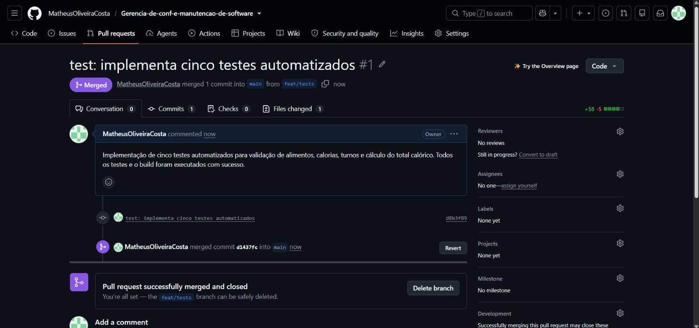
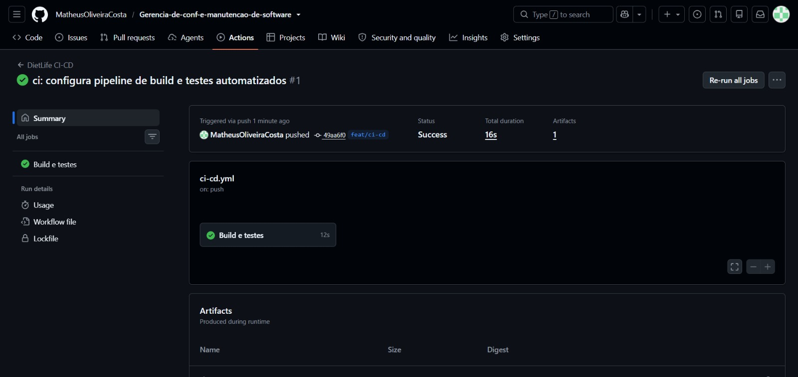
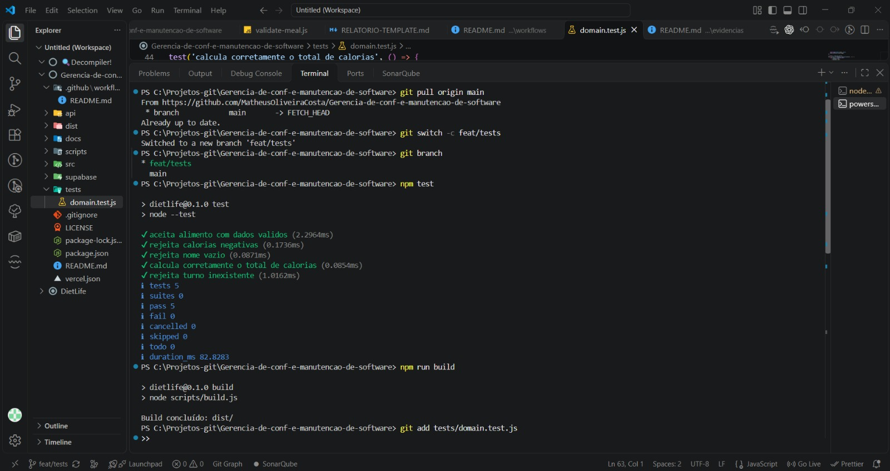
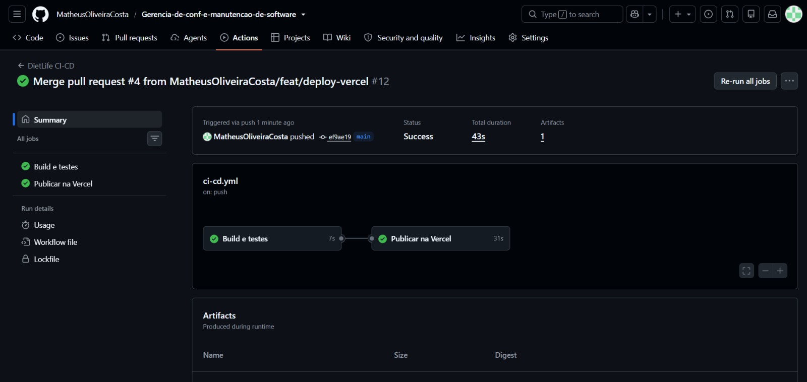
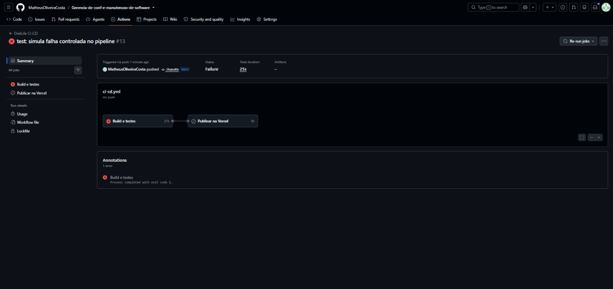

# Relatório técnico — DietLife

**Operação Deploy | Gerência de Configuração e Manutenção de Software**

Universidade Tecnológica Federal do Paraná — Engenharia de Software  
Profa. Eduarda Maganha de Almeida  
25/11/2026 — Cornélio Procópio, PR  
Turma: ES61

## 1. Identificação e contextualização

O DietLife é um diário alimentar web que permite organizar alimentos e valores calóricos por dia e turno. A proposta responde à necessidade de manter um registro simples de refeições e, principalmente, demonstrar o controle de versões e a entrega automatizada de software, conforme a atividade Operação Deploy.

| Integrante | Responsabilidade principal |
| --- | --- |
| Matheus Costa | Integração, Git, testes unitários, CI/CD e publicação |
| Alexandre de Lucas | Autenticação, persistência e Supabase |
| Camille Dal´ Lin | Interface, edição e exclusão |
| Matheus de Jesus | Testes de integração HTTP |
| Nelson Meirelles da Costa Junior | Documentação e evidências |

A divisão orientou o trabalho paralelo, com integração das contribuições ao repositório compartilhado. A proposta foi definida pela equipe como uma aplicação de diário alimentar. A identificação da turma e a aprovação da ideia própria devem ser confirmadas pela equipe antes do envio.

## 2. Escopo e funcionalidades

O código integrado contempla cadastro e consulta de alimentos por data, quatro turnos (café da manhã, almoço, café da tarde e jantar), edição, exclusão e cálculo dos totais diários. Os dados manipulados incluem nome, calorias, turno e data. A autenticação utiliza e-mail e senha e a persistência foi implementada para contas individuais.

A entrada é validada no domínio e na API HTTP; o schema do banco também prevê restrições de nome, calorias e turno. Não fazem parte do escopo prescrições nutricionais, recomendações alimentares, cálculo de macronutrientes ou planos de dieta.

Na validação manual em produção, o líder confirmou o funcionamento do cadastro de usuários, login e logout, cadastro, consulta, edição e exclusão de alimentos, recálculo das calorias, rejeição de entradas negativas, persistência após nova sessão e isolamento entre contas. Esses resultados são relatos da equipe, não testes automatizados. Inserir captura da aplicação em funcionamento com dados de demonstração.

## 3. Tecnologias e ambiente

A interface utiliza HTML, CSS e JavaScript em módulos ES. O Node.js 22 executa o servidor local, o build e os testes nativos. Git e GitHub controlam alterações; GitHub Actions automatiza as verificações e a Vercel hospeda a aplicação e a função HTTP de validação. Supabase Auth e PostgreSQL dão suporte às contas e refeições.

### 3.1 Arquitetura e execução

O navegador utiliza a API POST /api/validate-meal para validar dados de refeições. O adaptador de armazenamento utiliza o cliente Supabase para consultar e modificar a tabela public.meals, exigindo sessão ativa no modo remoto. Sem configuração remota, permanece o modo demonstrativo via localStorage. A API HTTP de validação é distinta da camada de persistência e autenticação.

Para executar: instalar Node.js 22, clonar o repositório, executar npm ci e npm run dev, e abrir http://localhost:3000. Para outra instância do banco, aplicar supabase/schema.sql e seguir supabase/README.md. Não inserir chaves privadas no código do navegador.

### 3.2 Implementação do backend e da autenticação

Conforme o relatório de Alexandre de Lucas (25/11/2026), a implementação ocorreu na branch feat/backend-auth, commit 1f7d4f7, com seis arquivos modificados ou criados (+686/−38 linhas). Foram preservados os contratos de interface do projeto, sem bundler ou novas dependências no package.json.

| Arquivo | Implementação |
| --- | --- |
| `supabase/schema.sql` | Script SQL idempotente: tabela public.meals, identificador UUID, user_id associado a auth.users, restrições de domínio e políticas RLS. |
| `src/js/supabase-client.js` | Cliente Supabase por módulo ES via CDN (supabase-js 2.119.2), URL do projeto e chave pública publishable; sem chave service_role. |
| `src/js/auth.js` | getSession, signIn, signUp, signOut e onAuthStateChange; tratamento de erros em português, sem armazenamento de senhas no navegador. |
| `src/js/storage.js` | Listagem, inserção, edição e remoção com sessão ativa; fallback local quando não há configuração remota. |
| `src/js/account-ui.js` | Integração do modal de conta, cabeçalho, e-mail autenticado e logout, evitando listeners duplicados. |
| `supabase/README.md` | Instruções de provisionamento, autenticação, teste de isolamento e limitações. |

O ambiente dedicado foi provisionado no plano gratuito do Supabase. O schema.sql foi executado no SQL Editor, ativando RLS na tabela meals. As políticas de SELECT, INSERT, UPDATE e DELETE restringem as operações ao proprietário (auth.uid() = user_id), com WITH CHECK nas operações que gravam dados. A chave pública no navegador não substitui o controle de acesso no banco.

O relatório individual registra build e cinco testes unitários aprovados antes da integração, bloqueio de acesso sem sessão, erro traduzido para credenciais inexistentes, criação de conta, exibição de e-mail e limpeza do estado no logout. A validação com dois usuários confirmou a persistência no PostgreSQL após recarregar a página e o isolamento de registros por user_id. Esses resultados são verificações manuais relatadas pelo responsável.

## 4. Organização e gerência de configuração

O repositório separa interface (src/), API (api/), scripts (scripts/), testes (tests/), configuração do Supabase (supabase/), documentação (docs/) e automação (.github/workflows/). As alterações foram organizadas em branches e integradas à main.

| Contribuição | Referência |
| --- | --- |
| Testes unitários | feat/tests; commit d8b3f89 |
| Pipeline e publicação | feat/ci-cd e feat/deploy-vercel; PR #4 |
| Edição e exclusão | feat/meal-crud; PR #5 |
| Autenticação e persistência | feat/backend-auth; 1f7d4f7; PR #6 |
| Testes de API | feat/integration-tests; PR #7 |

Figura 1 — Integração por Pull Request (testes automatizados).

## 5. Construção do pipeline de CI

O workflow .github/workflows/ci-cd.yml é acionado por push, pull_request para main ou execução manual. O job ci recupera o código, prepara o Node.js 22, instala dependências com npm ci, executa npm run build e npm test, e guarda a saída dist/ como artefato dietlife-build. A falha de um comando interrompe as etapas subsequentes.

Figura 2 — Primeira execução bem-sucedida do CI na branch feat/ci-cd, commit 49aa6f0.

## 6. Plano e execução dos testes automatizados

Os cinco testes unitários de tests/domain.test.js verificam funções do domínio diretamente. Os três testes de tests/api.test.js, desenvolvidos por Matheus de Jesus na branch feat/integration-tests (PR #7), percorrem o fluxo HTTP real da rota POST /api/validate-meal, incluindo servidor, leitura do JSON, handler, validação e resposta. Não exigem acesso ao Supabase.

| Tipo | Caso | Resultado esperado |
| --- | --- | --- |
| Unitário | Dados válidos | Aceitar |
| Unitário | Calorias negativas | Rejeitar |
| Unitário | Nome vazio | Rejeitar |
| Unitário | Soma 90 + 130 | 220 kcal |
| Unitário | Turno inválido | Rejeitar |
| Integração | Alimento válido | HTTP 200; valid: true |
| Integração | Calorias negativas | HTTP 422; valid: false; errors.calories |
| Integração | Nome ausente | HTTP 422; valid: false; errors.name |

A implementação usa node:test, node:assert/strict e fetch nativos do Node.js 22, sem novas dependências. O servidor scripts/server.js é iniciado como processo filho em porta livre; o teste aguarda a mensagem de prontidão (timeout de cinco segundos), envia requisições JSON e encerra o processo em um hook after, inclusive quando há falha. Nos casos inválidos, verifica-se também que errors contém apenas o campo esperado.

O relatório individual registra oito testes aprovados e build concluído. As execuções #30 e #31 confirmam a validação após a integração (seção 9), sem depender da confirmação pendente do CI no PR original.

Figura 4 — Evidência histórica da execução local dos testes unitários.

## 7. Entrega contínua, artefato e publicação

O job cd depende do job ci (needs: ci) e só é elegível para execução na main, fora de eventos de Pull Request. As credenciais VERCEL_TOKEN, VERCEL_ORG_ID e VERCEL_PROJECT_ID são recuperadas dos secrets do GitHub. A integração automática Git da Vercel foi desativada para evitar que uma publicação contorne as verificações.

A Vercel CLI obtém a configuração de produção (vercel pull), constrói a aplicação (vercel build --prod) e publica o resultado (vercel deploy --prebuilt --prod). O artefato do CI é guardado como evidência da construção; o CD reconstrói a versão a partir do mesmo commit, não consome diretamente esse artefato. O processo implementa entrega contínua e também implantação contínua, pois a publicação ocorre automaticamente após aprovação na main.

Figura 3 — Execução #12: CI e publicação na Vercel aprovados, commit ef9ae19.

Aplicação publicada: https://dietlife-xi.vercel.app/

## 8. Simulação de falha, bloqueio e recuperação

A equipe alterou propositalmente o valor esperado do teste de soma de 220 para 300 kcal. O teste reprovou, a execução #13 apresentou falha e o job de publicação não executou. Restaurando 220, a execução #14 voltou a aprovar build, testes e publicação. A simulação modificou a expectativa do teste, não a implementação do cálculo.

Falha: https://github.com/MatheusOliveiraCosta/Gerencia-de-conf-e-manutencao-de-software/actions/runs/45686777797
Recuperação: https://github.com/MatheusOliveiraCosta/Gerencia-de-conf-e-manutencao-de-software/actions/runs/45687103648

Evidências da falha e da recuperação: a execução #13 registrou Failure, duração de 25 s, nenhum artefato e publicação com duração de 0 s. A execução #14 registrou Success, duração de 54 s, um artefato e publicação em 39 s. A captura da falha está em docs/evidencias/05-falha-proposital-teste.png.jpeg. A captura da recuperação deve ser substituída pelo registro da execução #14 (link acima).

Figura 5 — Reprovação do CI e bloqueio da publicação.

**Recuperação:** [registro real da execução #14](https://github.com/MatheusOliveiraCosta/Gerencia-de-conf-e-manutencao-de-software/actions/runs/45687103648). Substituir a captura incorreta de recuperação por uma imagem dessa execução.

## 9. Resultado final e rastreabilidade

Os registros públicos de execução consultados em 25/11/2026 mostram a seguinte sequência de validações:

| Execução | Commit | Resultado |
| --- | --- | --- |
| #12 | ef9ae19 | Publicação inicial aprovada |
| #13 | 26abd6b | CI reprovado; CD não executado |
| #14 | 12fc3ff | Recuperação e publicação |
| #30 | a77765c | Integração dos testes HTTP aprovada |
| #31 | 3458188 | CI e CD aprovados; artefato gerado |

Repositório: https://github.com/MatheusOliveiraCosta/Gerencia-de-conf-e-manutencao-de-software
Aplicação: https://dietlife-xi.vercel.app/
Execuções: https://github.com/MatheusOliveiraCosta/Gerencia-de-conf-e-manutencao-de-software/actions
Última execução consultada: https://github.com/MatheusOliveiraCosta/Gerencia-de-conf-e-manutencao-de-software/actions/runs/45713082003

O script de build registra o commit em dist/version.json, possibilitando relacionar a versão ao código de origem. A execução #31, commit 3458188, é a última execução consultada nesta revisão; apresentou sucesso nos jobs de CI e CD e gerou um artefato de 12,8 KB. Caso haja novos commits de documentação, conferir a última execução da main.

A aplicação publicada foi validada manualmente pelo líder. O arquivo /version.json não pôde ser consultado nesta revisão externa; o commit 3458188 identifica a publicação confirmada na execução #31, e não uma leitura independente da versão servida atualmente.

## 10. Dificuldades, decisões e aprendizados

No início, arquivos da aplicação ficaram fora da pasta do repositório e outros não foram copiados. A equipe corrigiu a estrutura, verificou caminhos e repetiu a construção. Também houve um aviso de versão do Node.js (24 local versus 22 declarado), que não causou a falha de arquivo ausente; o CI foi padronizado em 22. Durante a configuração Git, uma branch foi criada posteriormente a um commit e um Pull Request fechado foi restaurado antes do merge.

A separação de responsabilidades reduziu a sobreposição de arquivos. A experiência mostrou que um build aprovado, isoladamente, não demonstra qualidade funcional e que a publicação deve depender dos resultados dos testes. O histórico preserva a evidência da falha e da correção.

## 11. Considerações finais

O projeto atingiu o objetivo de automatizar integração, construção, testes e publicação, conforme as execuções registradas. A validação funcional manual foi confirmada pela equipe. Os testes automatizados não abrangem a interface, a autenticação remota nem o isolamento real entre contas; esses aspectos foram verificados manualmente. Como evolução, podem ser adicionados testes de ponta a ponta, maior cobertura do backend e proteção da branch principal.

Para facilitar a avaliação acadêmica, a confirmação de e-mail foi desativada no Supabase Auth. Trata-se de uma limitação do ambiente de demonstração; em uma implantação real, recomenda-se habilitá-la e avaliar os demais controles de segurança.

## 12. Referências e declaração de uso de ferramentas

ALMEIDA, Eduarda Maganha de. Operação Deploy: enunciado da atividade de Gerência de Configuração e Manutenção de Software. UTFPR, 2026. Material fornecido à equipe.

GITHUB. GitHub Actions. https://docs.github.com/en/actions
NODE.JS. Test runner. https://nodejs.org/api/test.html
VERCEL. CLI. https://vercel.com/docs/cli
SUPABASE. Documentation. https://supabase.com/docs
DIETLIFE. Código-fonte, documentação e histórico de execução. https://github.com/MatheusOliveiraCosta/Gerencia-de-conf-e-manutencao-de-software (consultado em 25/11/2026).

DE LUCAS, Alexandre. Relatório de Implementação: Backend e Autenticação (DietLife). Relatório interno, 25 nov. 2026, 3 p.

DE JESUS, Matheus. Testes de Integração da API: DietLife. Relatório interno da equipe, 2 p.

### 12.1 Uso de inteligência artificial

A ferramenta ChatGPT (OpenAI) foi utilizada para planejamento, distribuição de tarefas, geração da estrutura inicial e de trechos de código e testes, configuração orientada do pipeline CI/CD, resolução de erros e organização da documentação. O líder executou os comandos, realizou commits e merges, configurou os serviços externos e acompanhou os resultados reais das execuções. As contribuições individuais foram integradas ao código principal.

A inteligência artificial foi empregada como apoio, não como substituição da validação prática. O líder revisou e adaptou as orientações e verificou os resultados de build, testes, publicação e recuperação. Cada integrante deve confirmar as ferramentas de IA que utilizou e as respectivas contribuições revisadas, bem como compreender o código e as configurações que apresenta.